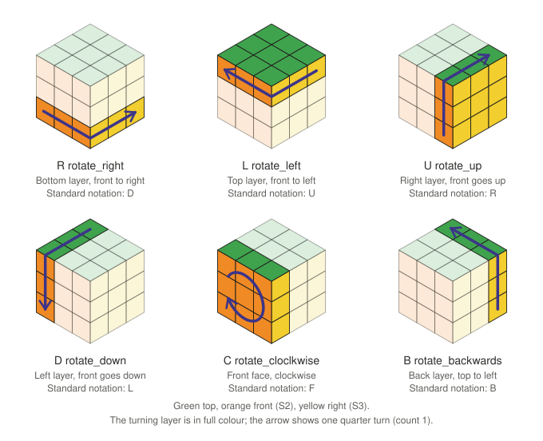

# Rubik's 3×3 Solver

Experimental Python solvers for a scrambled 3×3 Rubik's cube. Three search
front-ends — a hand-rolled solver, a [DEAP](https://deap.readthedocs.io/)
genetic algorithm, and a DEAP cooperative coevolution of solutions and move
blocks — share one cube model, one move encoding, and heuristic scoring. This
is research code, not a general-purpose solver: inputs are hardcoded, only the
coevolution solver has a CLI, and no search guarantees an optimal (or any)
solution.

## Layout

| File | Role |
|---|---|
| [cube.py](cube.py) | `Cube` state, the six move operations, heuristic counters, terminal rendering, validation. |
| [solution.py](solution.py) | `Solution`: move-sequence ("chromosome") handling and fitness evaluation used by [solver.py](solver.py). |
| [solver.py](solver.py) | Hand-rolled solver: exhaustive combination search (single/multi-threaded, multiprocess, meet-in-the-middle), then a mutation/crossover hill-climb. |
| [solver_deap.py](solver_deap.py) | Earlier DEAP genetic algorithm with hall-of-fame elitism, algorithm-aware mutation, and a fitness plot. Hardcoded parameters, no CLI or tests. |
| [solver_deap_coevolution.py](solver_deap_coevolution.py) | Main entry point: DEAP cooperative coevolution of solution candidates and evolving move blocks, with a CLI, selectable fitness functions, a persistent block library, diversity checks, the meet-in-the-middle finisher and optional adaptive recovery. |
| [test_solver_deap_coevolution.py](test_solver_deap_coevolution.py) | Deterministic `unittest` suite for the coevolution solver. |
| [test_mitm_finisher.py](test_mitm_finisher.py) | Tests for the meet-in-the-middle finisher (`--mitm`, on by default). |
| [test_adaptive_recovery.py](test_adaptive_recovery.py) | Tests for the optional adaptive population recovery (`--adaptive-recovery`). |
| [test_manual_mitm.py](test_manual_mitm.py) | Tests for the manual finisher trigger (pressing M during a run). |
| [test_best_candidate_display.py](test_best_candidate_display.py) | Tests for the Space shortcut that shows the current best candidate. |
| [benchmark_coevolution.py](benchmark_coevolution.py), [experiment_coevolution.txt](experiment_coevolution.txt) | Bounded comparison of the two DEAP solvers, and its recorded report. |
| [pyproject.toml](pyproject.toml), [uv.lock](uv.lock) | Project metadata, dependencies, and the lockfile used by [uv](https://docs.astral.sh/uv/). |

## Cube model ([cube.py](cube.py))

A cube is `Cube(top_face, row_of_faces, bottom_face)`: the four side faces in
a list between top and bottom. Each face is a 9-character string in row-major
order (indices `0..8`, centre at `4`) over the colours `Y R W O G B`:

```python
Cube(
                             "BRRBGYGGG",
    ["GBRRRGRRB", "YWWWWWRWW", "OOOOOOOOO", "YGWYYGYYG"],
                             "BBBRBBWYY"
)
```

Moves permute stickers by string slicing; `count` repeats a quarter-turn
`count` times. `clone()` deep-copies, `test_cube()` asserts every face has 9
valid stickers and each colour occurs exactly 9 times, `print_colored()`
draws an unfolded net via `colorama`, and `print_as_python_list()` dumps the
state in the literal form above (handy for pasting a found position back in
as a new starting cube).

Heuristic counters used for scoring: `count_solved_faces`,
`count_solved_edges`, `count_same_as_center` (stickers matching their face
centre), `count_triangles` (rows/columns through the centre matching it), and
`count_pieces_in_place` (staged beginner-method checks — white cross, second
layer, yellow cross/edges/corners — that bail out as soon as a stage fails).

## Move encoding ([solution.py](solution.py))

A move is a 2-character gene: a direction in `R L U D C B` plus a count
`1..3` (quarter-turns, so `3` is one counter-turn). A chromosome is genes
concatenated, e.g. `L3U2C2L1...`. These letters are internal directions, not
standard Singmaster notation:

| Gene | `Cube` method |
|---|---|
| `R` / `L` | `rotate_right` / `rotate_left` |
| `U` / `D` | `rotate_up` / `rotate_down` |
| `C` / `B` | `rotate_cloclkwise` *(sic)* / `rotate_backwards` |

The letters say how a layer moves, not which face turns. `R` / `L` turn the
bottom / top layer, `U` / `D` the right / left layer, `C` the front face
clockwise and `B` the back face. The picture uses the default orientation:
green top, orange front (`S2`), yellow right (`S3`).



`Solution.calculate_fitness(cube, chromosome, ...)` applies the genes to the
cube **in place** (callers pass a clone), scoring after every gene as

```
pieces_in_place + solved_faces + triangles + same_as_center − step/100
```

and returns `(best_index, fitness)` under one of three `Mode`s: `MAX` (best
prefix), `LAST` (final position), or `CUMULATED` (sum over steps). Reaching
six solved faces returns early with `solved_fitness − step`. `Solution` also
provides random gene generation and point mutation; note
`simplify_chromosome()` currently returns its input unchanged (the merging
logic below the `return` is dead code).

## Hand-rolled solver ([solver.py](solver.py))

`solver.py` first enumerates **all** move combinations up to `N = 6` genes
into `combinations.txt`, then scores them against the hardcoded scramble in
the mode selected by `Processing` (currently `MEET_IN_THE_MIDDLE`):

- `SINGLE_THREAD` — greedily appends the best-scoring combination chunk by
  chunk, re-targeting the "almost complete" colour as fitness saturates.
- `MULTI_THREAD` / `MULTI_PROCESSING` — split the combination list across 8
  threads / 6 processes and keep the best `Mode.LAST` score per worker
  (the threaded variant discards worker results, so it is a benchmark only).
- `MEET_IN_THE_MIDDLE` — applies every combination to a solved cube and
  records `move:state` lines in `combinations_solved.txt`, keeping the
  shortest move per state in a dict. It then applies the same combinations
  to the scramble; on a state match it reverses the solved-side sequence
  (gene order flipped, `1`↔`3`, `2` unchanged), concatenates it after the
  scramble-side sequence, verifies, and exits.

Afterwards a hill-climbing loop runs until near-solved: each round mutates
the incumbent chromosome or crosses it with a fresh random one at the best
index, keeping only improvements, and raises the mutation rate after
50 000 stagnant rounds.

As shipped, `JUST_READING = True`, so it expects `combinations.txt` (and
`combinations_solved.txt` for meet-in-the-middle) to already exist; neither
is in the repo. Flip it to `False` to regenerate them — the combination set
grows as 18^length, so this is slow and memory-hungry.

## DEAP solver ([solver_deap.py](solver_deap.py))

A module-level script (it runs on import; there is no `main()` guard). An
individual is 12 integers (`MAX_GENES`), each indexing the 18 moves
`R1..B3`. Fitness is minimised (`FitnessMin`, weight `-1`).

The active fitness, `evaluate_individual_manhattan_misplaced`, clones the
target cube, applies the moves, and scores **every prefix**: it keeps the
best value of `manhattan + (moves used / MAX_GENES)` (misplaced-sticker
weight is currently `0`), so shorter prefixes win ties. `manhattan_distance`
is a colour-mismatch heuristic, not a true move distance: for each sticker it
adds the grid distance between its own colour's block and its face centre
colour's block on the unfolded net (the sticker's position within the face
cancels out).
Side effects track the global best-ever prefix length (`min_moves`), which
`print_best()` uses to show the effective solution. Simpler alternatives
(misplaced-sticker count, final Manhattan distance) remain registered-out.

Genetic operators:

- **Selection**: tournament (size 5); a 1-member Hall of Fame is re-injected
  each generation by the custom `eaSimpleWithElitism` loop (elitism).
- **Crossover**: one-point, probability `0.001`.
- **Mutation** (probability `0.9`, `mutate_individual_mixed`): 45 % replace a
  uniformly random gene, 45 % replace a gene biased toward the tail of the
  chromosome, 10 % splice in a known CFOP fragment from `translated_algs`
  (beginner layer-by-layer triggers, OLL/PLL examples) translated into the
  internal encoding.

Defaults are population 5000 × 5000 generations. Every 25 generations it
prints the hall-of-fame individual and its cube; at the end it applies the
best individual, prints the resulting cube and misplaced-sticker count, and
plots min/average fitness with `matplotlib` (`plt.show()`).

The starting cube is also hardcoded — and deliberately so: `my_cube` is
reassigned several times to progressively more-solved positions copied from
earlier runs (see the commented "Best individual moves" blocks), so the
script currently continues from the last checkpoint rather than from the
original scramble.

## Cooperative coevolution solver ([solver_deap_coevolution.py](solver_deap_coevolution.py))

The main entry point, a DEAP solver that evolves two populations together:

- **Solution candidates** are move sequences applied to the input cube. Each
  candidate is normalised to its best prefix and stored as exactly that
  reduced sequence, padded with `NOOP`, so the stored moves are the ones that
  produced its score. Candidates rank by `(unsolved, H(endpoint), length)`,
  all minimised.
- **Move blocks** are reusable combinations of up to 16 moves, scored on a
  shared batch of up to 16 solution endpoints ("contexts": the original cube,
  the best elite states, and a random sample of other states). A block is
  useful on a context when some prefix lowers `H` by at least
  `--min-block-gain`, so a block may pass through worse states first.

Each generation keeps the best 20 % of solutions unchanged, replaces the
worst 20 % with empty candidates, and breeds the middle 60 % by appending
or splicing blocks, varying single moves, or crossover. A fixed share of those
offspring always restarts from the empty candidate. The block population keeps
10 % elites, breeds 60 % with seven operators, and draws 30 % fresh blocks,
with a cap on duplicate sequences.

Moves use the same `R L U D C B` letters with counts `1..3`, plus `NOOP`. A
shared simplifier merges same-face turns and commutes opposite faces (`R`/`L`,
`U`/`D`, `C`/`B`), so reported lengths are reduced, not globally minimal.

### Fitness functions

Select the solution-state cost with `--fitness NAME`; the source-code default
is `manhattan`. **Lower `H` is better**, and all nine choices below give zero
for a solved cube. Solved status is checked independently by comparing every
sticker with its face centre. Candidates rank by `(unsolved, H, length)`, so
solved candidates win first, then lower cost, then shorter reduced sequences.
Every accepted archive improvement is replayed from the original input.

The formulas use these quantities:

- `M`: misplaced stickers, each compared with its own face centre (0–48;
  centres never contribute).
- `D`: the legacy colour-offset Manhattan sum. For each sticker, sum the
  absolute coordinate differences between its colour and its face-centre
  colour in the fixed layout `G=(0,0)`, `R=(0,3)`, `W=(0,6)`, `O=(3,0)`,
  `Y=(3,3)`, `B=(3,6)`. This is a colour-mismatch score, not a sticker's
  physical travel distance; changing colour labels can change the score.
- `C` and `E`: sums of individual shortest move distances home for the eight
  corners and twelve edges, respectively, including position and orientation.
  Each piece is considered independently, ignoring the others. `S = C + E`
  is the `cubie` cost, bounded above by 52.
- `P`: sum of five exact pattern distances: two groups of four corners and
  three groups of four edges. Each group is solved jointly, ignoring pieces
  outside that group. Distances use all 18 face turns; a half turn such as
  `R2` counts as one move.

| `--fitness` value | Cost `H` | What it rewards | Limitations / interpretation |
|---|---|---|---|
| `manhattan` **(default)** | `D` | Reducing sticker colour-offset mismatches. | Cheap legacy heuristic; its fixed colour layout does not model cube move distance or interactions between pieces. |
| `manhattan-min` | `D` | Exactly the same states and ordering as `manhattan`. | Compatibility alias; it does not perform an additional minimum-distance search. |
| `misplaced` | `M` | Putting more stickers on faces with matching centre colours. | Simple count with many ties; one wrong sticker counts equally regardless of how hard it is to correct. |
| `manhattan-misplaced` | `wD * D + wM * M` | A configurable trade-off between colour-offset mismatch and misplaced-sticker count. Both weights default to `1.0`. | Weighted sum, not strict priority: an improvement in one component can compensate for worsening the other. |
| `cubie` | `S` | Reducing the total distance of individual pieces from their correct positions and orientations. | Considers each piece alone; a turn moves multiple pieces, so the sum is not the number of moves remaining. Local minima and ties remain possible. |
| `cubie-refined` | `64 * S + M` | Cubie distance first; fewer misplaced stickers breaks ties. | Strict priority because `M <= 48 < 64`. Adds discrimination within cubie ties but cannot accept a worse cubie sum in exchange for fewer misplaced stickers. |
| `grouped-cubie` | `4096 * P + 64 * S + M` | Joint four-piece distances first, individual cubie distances second, misplaced stickers third. | Captures interactions within each group. Priority is strict; the sum across groups is still a heuristic. Requires additional pattern tables and scoring work. |
| `grouped-corners` | `4096 * (2 * Pc + Pe) + 64 * S + M` | Like `grouped-cubie`, but the two four-corner pattern distances (`Pc`) count double against the three edge patterns (`Pe`), so corner progress and preservation weigh more. | Not a strict corner phase: edge gains can still outweigh corner regressions across the tiers. Benchmarked below `grouped-cubie` overall (6/40 vs 11/40 solves in a local 40-run comparison during development — two scrambles × 20 seeds, not a benchmark shipped in this repo), despite ending with corners home far more often. |
| `grouped-alternating` | phases of `grouped-corners` / `grouped-cubie` | Starts as `grouped-corners`; switches to `grouped-cubie` once a best-ever cube that arrived in the current phase has every corner home, back once one has every edge home, never switches before a phase has run 100 generations (`DEFAULT_ALTERNATING_MIN_PHASE_GENERATIONS`), and toggles phase after more than 500 generations without a cube-quality (solved, H) improvement — a shorter sequence at equal H does not count. Archive and population are re-scored at each switch; switches are printed as they happen and listed in the final report. | H values before and after a switch are on different scales and not directly comparable. Experimental: intended to break long stagnation plateaus by changing what selection rewards. |
| `corners-first` | `37 * C + E` | Corner distance first; edge distance breaks ties at every corner score. | Strict priority because `E <= 36`. Edges contribute even before corners are home. Once corners are solved, useful edge sequences may temporarily disturb them, so complete multi-move proposals matter. |
| `edges` | Number of incorrectly positioned or oriented cubies (0–20) | Increasing the number of completely correct pieces. | Despite its name, includes **both eight corners and twelve edges**. Each wrong piece contributes one regardless of its distance home, so the score is coarse and can saturate. |

These costs are selection heuristics; do not treat their values as certified
remaining-move counts or admissible lower bounds. None guarantees convergence
or a shortest solution.
Although each individual/group distance is exact for its smaller problem,
adding them can count the effects of the same turn more than once. Compare
costs within the same objective and weights, not across different objectives.

Set `--manhattan-weight` and `--misplaced-weight` only with
`--fitness manhattan-misplaced`. Weights must be finite and nonnegative, at
least one must be positive, and combinations that overflow are rejected.
Changing the scale also changes what qualifies under the absolute
`--min-block-gain` threshold (default `1.0`). The persistent block library
always uses its own fixed `cubie-refined` reference evaluator, independent
of the run's selected fitness.

```bash
uv run python solver_deap_coevolution.py --fitness cubie-refined --seed 42
uv run python solver_deap_coevolution.py --fitness corners-first --seed 42
uv run python solver_deap_coevolution.py --fitness manhattan-misplaced --manhattan-weight 1 --misplaced-weight 0.25 --seed 42
```

Normalisation keeps the best prefix of a complete proposal, including the
empty prefix. Equal-cost longer prefixes lose to shorter ones. A complete
proposal may pass through worse intermediate states and still be retained
if its eventual best prefix improves the ranking; a low score does not mean
that every next useful move will lower it.

`cubie`, `cubie-refined`, `corners-first`, `grouped-cubie`,
`grouped-corners`, and `grouped-alternating` also validate
that the input contains a consistent set of distinct cubies. This check
alone does not establish physical solvability.

For `grouped-cubie` (and `grouped-corners`, which reuses its tables), groups follow the deterministic slot order derived from
`cube.py` within each piece type; they are not explicitly grouped by layer.
Its priority scales are safe because `64 * 52 + 48 < 4096` and `48 < 64`.
The five pattern tables are built lazily once per process, before the search
timer starts, using all 18 turns (a half turn costs one move). Their direct
indexing uses about 1.6 MiB of distance data, including unused overlap entries;
construction needs additional temporary memory. Nothing is saved to disk.
Scoring decodes each piece once: a lookup supplies its pattern-index
contribution, solo distance, and misplaced-sticker count together.

### Input and command-line options

Unlike the older scripts it has a `main()` guard and no import side effects.
The input is still hardcoded: `default_input_cube()` is a fully scrambled cube
(`H` = 198 under `manhattan`, cubie cost 32). Other cubes can go through the
library call `run_search(SearchConfig(...), cube)`. Defaults: 1000 solutions,
500 blocks, 10000 generations, solution capacity 64, block capacity 24 and 16
contexts. Main options: `--seed`, `--fitness`, `--time-limit`,
`--generations`, the population, capacity and context sizes, and `--plot`
(saves `coevolution_progress.png` without opening a window). Exit codes: `0`
verified solve, `1` budget exhausted, `2` invalid input, `3` internal or
replay error, `130` interrupted.

### Population diversity and stagnation warnings

After every 50th completed generation the solver measures the solution
population and prints a short summary
([specification](solution_population_diversity_specs.md)). It only measures and
warns; selection, mutation and every other part of the search are unchanged.

- **Reset slots excluded:** the three diversity thresholds use the non-reset
  candidates (elites, offspring and baseline-start offspring, empty ones
  included). The current generation's 20% reset slots, which are intentionally
  identical, are excluded; whole-population values are shown for context only.
- **Warnings** (any one is enough; all active ones are listed together):
  `LOW_UNIQUE_STATES` below 10% distinct endpoint states, `DOMINANT_STATE` one
  state holding over 80%, `LOW_CUBIE_SPREAD` an exact mean below 2 differing
  cubies (position or orientation, out of 20) between candidates, and
  `NO_QUALITY_PROGRESS` 100 or more generations without a better
  `(solved, H)`. A shorter sequence at the same `H` does not count as progress.
- **Low diversity is not the same as a stalled search:** a population can
  converge while approaching a solution, and progress can stall in a diverse
  population, so each warning says which it is. A recovery note appears once
  when no threshold is crossed any more.
- `--diversity-min-unique-ratio`, `--diversity-max-dominance`,
  `--diversity-min-cubie-distance` and `--stagnation-generations` change the
  thresholds (not the 50-generation schedule); `--no-diversity-checks` turns the
  feature off. Each check's record is attached to that generation's history row
  and to `RunResult.diversity_records`.
- The checks add a few milliseconds per checkpoint and count toward
  `--time-limit`, so a time-limited run may complete slightly fewer generations;
  fixed-generation runs produce exactly the same search with the checks on or off.

### Persistent move-block library

The CLI keeps a shared library of up to 100 distinct move blocks across runs,
independent of the starting cube, seed and `--fitness`
([specification](persistent_move_block_library_specs.md)). It lives at
`$XDG_DATA_HOME/rubik3x3solver/move_blocks_v1.json` (else
`~/.local/share/...`); `--block-library PATH` overrides it and
`--no-block-library` turns all library reads, writes, scoring and seeding off,
reproducing the plain search exactly. Library callers opt in with
`SearchConfig(block_library=path)`; it is off by default there.

- **Distinct** means a different 54-sticker permutation: `R1 R1` and `R2`, or
  two spellings of the same algorithm, share one slot, keeping the shortest
  known sequence. Identity blocks are dropped.
- **Best** means the ranking on a fixed, versioned panel of 48 scrambles,
  scored with `64 * cubie + misplaced` whatever the run's objective: more
  solved panel states, then more improved ones, then the larger summed relative
  gain, then fewer moves. The complete block is scored, never its best prefix.
- Candidates are submitted after the first block batch, every 50th generation
  and at the end, plus the exact blocks behind each new best solution. Reference
  scoring counts against the time budget and stops at it without saving
  partial scores.
- A new run seeds at most a quarter of its first block population from the
  library (blocks that fit `--block-capacity`), fills the rest with fresh
  blocks, and scores every block on its own contexts before selection.
- The file is plain JSON, validated in full before use. Saves merge with the
  latest file under an OS lock and replace it atomically. A corrupt,
  incompatible or locked library is reported, left untouched and never changes
  the solver's result.
  A failed load disables further library collection and scoring for that run.
  After timeout or interruption, saves can use already verified cached scores;
  if concurrent additions require fresh reference scoring, the save is deferred
  with a diagnostic and the current disk file is preserved.

### Meet-in-the-middle finisher

The CLI runs an exact, bounded search that tries to finish the best-ever
candidate once only a few cubies are wrong. Automatic attempts are on by
default; `--no-mitm` turns them off, and with them off nothing about the
search changes. Pressing M still requests a single attempt (see **Manual
trigger** below). Library
callers opt in with `SearchConfig(mitm=True)`; it is off by default there.
The first attempt in a run builds or loads the solved-side table (see
**Table cache** below).

- **Search:** a table of every state within `floor(D/2)` moves of solved is
  joined with a breadth-first search to `ceil(D/2)` moves forward from the
  candidate's endpoint, so a finished search finds the shortest solving suffix
  of at most `D` moves (`--mitm-depth`, 1–10, default 10). States are compared
  by exact identity after recolouring to the face centres. The only pruning is
  skipping a second turn of the same face, which is always safe. Worse
  intermediate fitness is never pruned, and the GA's random numbers are never
  used, so attempts are deterministic.
- **Triggers:** an attempt starts when at most `--mitm-trigger-cubies` (4)
  corners plus edges are wrong in position or orientation. With
  `--fitness corners-first` it also starts once every corner is home and at
  most `--mitm-corners-first-edge-trigger` (6) edges are wrong. The finisher
  checks once after setup and then after completed generations, at most once per
  `--mitm-interval` (50) generations. It only works from the best-ever
  candidate and skips solved endpoints.
- **Joining:** the suffix is appended to the candidate's moves. The joined
  sequence is simplified across the join, state loops are removed, it is
  shortened, normalised and replayed through `cube.py` before use. Capacity
  is checked after these reductions, so a raw join longer than
  `--solution-capacity` can still fit. A solving path that stays too long is
  reported as such.
- **Fallback:** when no solution is found, the finisher keeps up to 32
  forward paths that strictly improve the selected fitness and fit after
  simplification, plus up to 8 that do not. All of them are joined, reduced and
  normalised, and the best final result is used, so a path that only fits after
  shortening can still win. These are only the forward half (at most
  `ceil(D/2)` moves), so this is not the best improvement among all `D`-move
  sequences.
- **Results:** a solve ends the run through the normal verified-solve path. An
  improvement becomes the best-ever entry and replaces the worst-ranked
  offspring of the just-published population. Elite copies, resets and the
  population size stay the same. Results found right after setup wait for
  generation 1, so the all-NOOP initial population is never changed. The
  suffix is offered to the block library like any other improving block.
- **Time:** each attempt's forward search and result processing get
  `--mitm-attempt-seconds` (10). Table preparation (building or loading the
  table, writing the cache, and the one-time shortening table) does not count
  toward that limit. All attempts together, preparation included, get
  `--mitm-total-seconds` (30). Every phase checks these limits, `--time-limit`
  and Ctrl+C.
  - When the attempt time runs out during result processing, the best result
    processed so far is used. Only its final replay and insertion run after
    the deadline.
  - An overall stop discards an unsolved improvement but keeps a solve that
    was already verified.
  - An attempt that runs out of time is reported as "timed out", never as
    "more than `D` moves away".
  - The finisher never repeats an attempt on the same endpoint, except one
    whose table preparation was cut short. A cache write that was cut short is
    retried at the next preparation.
- **Table cache:** the depth-5 table (621,649 states, about 12 MB on disk and
  about 200 MB in memory) takes about 1.5 s to build and 0.3 s to load. It is
  built only when the first attempt needs it and kept in memory for later
  attempts. It is cached at
  `$XDG_CACHE_HOME/rubik3x3solver/mitm_solved_side_v1_depth5.bin` (else
  `~/.cache/...`); `--mitm-cache-dir DIR` moves it and `--no-mitm-cache` keeps
  it in memory only. The file carries a format version and a fingerprint of
  the move model. It is checked against the exact number of states at each
  distance, written atomically, and rebuilt when stale or corrupt. A stopped
  build resumes at the next attempt.
- **Keys during a run:** in an interactive terminal, the startup line says
  "Press Space to show the current best candidate; M to request MITM."
  - Space (no Enter) prints the current best-ever candidate under the active
    fitness, labelled "Current best solution candidate". It shows when it was
    taken, the fitness and current phase, `H` and solved status, where and
    how the candidate was found, its moves (or that it is the unchanged input
    cube) and its cube, coloured and as a Python literal. Repeated presses
    coalesce.
  - The display is served at the solver's next cooperative check, usually
    within moments, even mid-generation or during a MITM attempt, which it
    does not interrupt. It only reads the candidate: populations, archive,
    counters, random numbers and scheduling are unchanged, and it never
    counts as an improvement.
  - Space and M are independent: neither consumes or blocks the other.
- **Manual trigger:** pressing `M` or `m` (no Enter) requests one attempt on
  the current best-ever candidate. It prints
  "Manual MITM requested; will run at the next safe generation boundary."
  and runs when the current generation finishes, so it may wait a while with
  large populations.
  - The attempt uses the best-ever candidate and the active fitness at that
    boundary, not at the moment of the key press.
  - It skips the automatic trigger, interval and same-endpoint rules, and
    runs even with `--no-mitm`, without turning automatic attempts on.
  - It keeps `--mitm-depth`, `--mitm-attempt-seconds`, the shared
    `--mitm-total-seconds`, `--time-limit`, Ctrl+C and the usual result
    handling. A solve ends the run after verification, a strict improvement
    joins the population as above, and otherwise nothing changes.
  - At most one attempt runs per boundary, and a manual request goes before
    an automatic one. Repeated presses while one is queued or running are
    ignored. A request that cannot run is dropped with its reason in the log.
  - Only the key reader touches the terminal: it reads keys in a background
    thread and only queues requests. On macOS and Linux it switches the
    terminal to single-key input with echo off, keeps Ctrl+C working, and
    restores the terminal on every exit. On Windows it uses `msvcrt`
    (untested).
  - With redirected or piped input it never reads stdin, and the startup line
    says the shortcut is unavailable.
- **Output:** each attempt prints one `[finisher gen N]` line marked
  `automatic attempt` or `manual attempt`.
  - The line gives the counts of wrong cubies, the table and forward depth
    reached, how the search ended, states and time, and the result and where
    it went.
  - It ends with the outcome (solved, improved, no usable improvement or
    stopped) and the attempt time. Table preparation time is shown
    separately.
  - A manual attempt also prints when it starts or why it was skipped.
  - The final report gives the number of attempts (how many were manual) and
    the total finishing and preparation time.

A complete depth-10 forward search visits 621,648 states. Under CPython it
takes about 2.9 s with `manhattan`, 3.1 s with `cubie` and 5.1–5.4 s with
`grouped-cubie` or `grouped-corners`; under PyPy the grouped fitnesses take
5.9–6.7 s. The 10 s default lets it finish with any of them, and an attempt
that completes or solves earlier returns at once. The 30 s total then allows
about five complete attempts per run.

Measured with 200 solutions, 100 blocks, solution capacity 32, block capacity
16 and 16 contexts, `manhattan`, CPython, 60 s per run, seeds 42–44, and the
earlier 2 s attempt limit:
- **8-move scramble:** solved in 3 of 3 runs with the finisher (in 2.7–6.5 s,
  11 moves) and in 0 of 3 without it.
- **Default cube** (4 edges wrong, more than 10 moves away): solved in 1 of 3
  runs with the finisher and 0 of 3 without it.
- **10- and 12-move scrambles:** the finisher never started, because the
  search never got down to 4 wrong cubies, and the results were identical.

Cold and warm caches made the same attempts at the same generations. They
differed only in preparation time: 1.4–1.5 s to build the table, 0.3 s to load
it.

### Adaptive population recovery

`--adaptive-recovery` lets the solver step in when the search is stuck and its
population has also lost diversity. It is off by default, and with it off the
search is unchanged. It needs the diversity checks, so combining it with
`--no-diversity-checks` is a configuration error. All of its thresholds are
starting values that still need benchmarking.

- **Trigger:** a scheduled health check (every 50 generations) qualifies when
  it shows `NO_QUALITY_PROGRESS` together with at least one of
  `LOW_UNIQUE_STATES`, `DOMINANT_STATE` or `LOW_CUBIE_SPREAD`. These use the
  same thresholds as the warnings. Low diversity while quality still improves,
  stagnation alone, or an unavailable measurement does not qualify, and any
  check that does not qualify resets the count.
  `--recovery-consecutive-checks` (2) qualifying checks in a row make an
  intervention eligible. The evidence is then used up, so the next intervention
  needs new consecutive checks.
- **Cooldown:** at least `--recovery-cooldown-generations` (100) completed
  generations between interventions. The cooldown is tracked separately from
  the stagnation count, and recovery never resets that count; only a better
  `(solved, H)` does.
- **Finisher first:** with the finisher on (the CLI default), that
  boundary's finisher attempt runs before recovery is decided, under the
  finisher's own triggers, cache and budgets. A finisher improvement goes
  into the population and postpones recovery; a solve ends the run as usual.
- **First intervention (solutions only):** the next generation keeps the usual
  20% elite copies and 20% empty resets and rebuilds the 60% offspring portion.
  40% of those slots are fresh reduced sequences of 4–16 moves from the input
  cube. 40% are 2–4 of the usual move variations applied in a row to one
  parent. 20% insert one block into a parent and append a second, different
  one.
  - Parents cycle through the distinct endpoints of the usual parent pool in
    shuffled order, so every endpoint, the best included, is used once before
    any repeats.
  - Each complete proposal is normalised and verified once, as usual, so a
    proposal may pass through worse states on the way.
  - A slot whose normalised endpoint is already in the new population retries
    up to 3 times, then keeps its last valid proposal and counts as a
    uniqueness shortfall.
  - Offspring are not filtered by fitness, and the archive rules are
    unchanged.
- **Escalation (adds a partial block refresh):** this happens only on a later
  intervention when the best-ever quality has not improved since the previous
  one. The block population must also have been unhealthy at 2 consecutive
  checks, measured on the latest shared-context evaluation. Unhealthy means
  fewer than 50% distinct move transformations (equivalent spellings count
  once) or no block improving any context. Here improving means any lower cost
  within the solution capacity, whatever `--min-block-gain` is. A missing or
  stale evaluation is not counted as unhealthy. The escalation is checked again
  after the recovery generation's block evaluation and is dropped if that
  evaluation improved the best-ever quality.
  - The refresh replaces up to `--recovery-block-refresh-fraction` (0.25, at
    most 0.5) of the blocks.
  - The top tenth of the blocks is protected, as is the best block of every
    improving transformation. Redundant weak blocks go first, then redundant
    improving ones, then distinct blocks that improve no context.
  - Replacements alternate fresh and varied blocks under the usual capacity
    and duplicate cap, preferring new transformations. They are scored on the
    same batch before anything uses them.
  - The persistent block library is never cleared or rewritten.
  - A genuine quality improvement resets escalation.
- **Interruptions:** an intervention is built while the next generation is
  constructed, so a timeout or Ctrl+C keeps the last fully published
  population.
- **Output:** each check prints the block health and the recovery condition.
  Each intervention prints separately from the warnings:
  - when it was scheduled and applied, and its trigger IDs and streak
  - the generations without better quality
  - the finisher outcome
  - the counts of elites, recovery offspring by kind and resets, plus the
    novelty retries and shortfall
  - the block refresh with its health evidence, or the reason it was skipped
  - endpoint diversity before and after publication
  - the time it took
  The final report counts interventions and total recovery time. Higher
  diversity after an intervention is not, by itself, evidence that it helped.

**Limitation:** normalisation keeps only the best-scoring prefix of each
proposal, and the empty prefix counts, so a stored candidate's state is
strictly better than the input cube's. A proposal that never gets better than
the input is normalised back to the empty baseline. One that does is kept,
even when the whole population sits on the baseline. For example, on the
default cube `B3 U3 R2 U1 R1 U1 R3 U3 R3 U3 R3 U1 R3 U1 B1` survives
normalisation unchanged and lowers `manhattan` from 36 to 30. In the benchmark
below, none of the sampled recovery proposals found such a sequence, so
diversity did not rise. That was a sampling failure, not an impossibility.

Measured with 200 solutions, 100 blocks, solution capacity 32, block capacity
16 and 16 contexts, `manhattan`, 60 s per run, seeds 42–44: nothing was solved
in 12 runs with recovery or 12 without.
- **Default and checkpoint cubes:** recovery fired 38–67 times per run and
  took 1.0–1.7 s in total.
  - Where the search stayed on the empty baseline (both checkpoint runs, and
    the default cube with seed 44), every intervention ended with all 120
    offspring on the baseline endpoint. Diversity stayed at 1/160, and the
    final `H` matched the runs without recovery.
  - On the default cube with seeds 42 and 43, the runs left the baseline and
    their trajectories diverged: seed 42 reached `H` 18 both ways (earlier with
    recovery), and seed 43 reached `H` 24 with recovery against 18 without.
  - The unique-endpoint ratio after an intervention was within 0.1 percentage
    points of the ratio before it.
- **8- and 10-move scrambles:** the population stayed diverse while it
  stalled, so recovery never fired. The final results matched the runs without
  it. At a fixed 300 generations, recovery mode took 19.75 s against 19.77 s.

These runs show no benefit on these cubes; three seeds per cube are not enough
to measure a small effect either way.

## Benchmark ([benchmark_coevolution.py](benchmark_coevolution.py))

Runs both DEAP solvers on the active checkpoint from `solver_deap.py` for
seeds 42, 43 and 44, with 120 s, solution capacity 32 and population 200 per
run, serially in fresh subprocesses. The benchmark keeps its own copy of that
cube and of the spec's original block settings (100 blocks, capacity 16, 16
contexts), so it does not follow the coevolution solver's defaults.
`solver_deap.py` is read from disk and changed in memory only
(seed, `MAX_GENES`, `POPULATION_SIZE`, generation ceiling, no final plot),
plus read-only hooks that enforce the time limit and record its best prefix.
The report goes to `experiment_coevolution.txt`, numbered if that file exists.

In the recorded run ([experiment_coevolution.txt](experiment_coevolution.txt))
neither solver solved or improved the active checkpoint: `H` stayed at 24.
The coevolution solver ran about 9,500 generations per run to the GA's
1,900, but no block of up to 16 moves lowered this near-solved cube's cost.
Three seeds describe behaviour on one cube; they are not a solve rate.

## Running

Install [uv](https://docs.astral.sh/uv/getting-started/installation/), then
run the solvers from this directory. `uv run` creates `.venv` on first use,
installs the locked dependencies (`colorama`, `deap`, `numpy`, `matplotlib`),
and uses the Python in [`.python-version`](.python-version) (3.12), downloading
that interpreter if it is not already installed.

```bash
uv run python solver_deap.py   # DEAP genetic algorithm
uv run python solver.py        # needs combinations*.txt, see above
uv run python solver_deap_coevolution.py --seed 42   # coevolution; --help lists options
uv run python solver_deap_coevolution.py --fitness cubie-refined --seed 42
uv run python solver_deap_coevolution.py --fitness grouped-cubie --seed 42
uv run python solver_deap_coevolution.py --seed 42 --block-library my_blocks.json
uv run python solver_deap_coevolution.py --seed 42 --no-block-library
uv run python solver_deap_coevolution.py --seed 42 --no-mitm   # no automatic finisher attempts; M still requests one
uv run python solver_deap_coevolution.py --seed 42 --adaptive-recovery
uv run python -m unittest test_solver_deap_coevolution -v
uv run python -m unittest test_block_library -v
uv run python -m unittest test_population_diversity -v
uv run python -m unittest test_mitm_finisher -v
uv run python -m unittest test_adaptive_recovery -v
uv run python -m unittest test_manual_mitm -v
uv run python -m unittest test_best_candidate_display -v
uv run python benchmark_coevolution.py   # ~15 minutes
```

`uv sync` only installs the environment, without starting a solver.

To solve a different scramble, replace the active `Cube(...)` literal in the
script you run, keeping exactly nine stickers of each colour —
`test_cube()` will assert otherwise.

## Limitations

- `solver.py` and `solver_deap.py` use hardcoded inputs and parameters, with
  no arguments or tests. The coevolution solver has a CLI and tests but still
  starts from a hardcoded input cube. Dependencies are installed with uv.
- The coevolution solver solves short scrambles (up to about 6 moves in
  testing) but did not get past the active checkpoint's plateau in the
  benchmark. On the scrambled default, with 2000 solutions and 1000 blocks, it
  typically reached `H` 60–80 within 30 generations and then stalled; none of
  those test runs solved it.
- Fitness is a heuristic, not an admissible bound: search can stall at local
  optima and solutions are neither guaranteed nor minimal.
- Exhaustive modes materialise every combination in memory/on disk and do
  not scale beyond short sequences; the DEAP run is similarly expensive at
  the shipped population/generation sizes.
